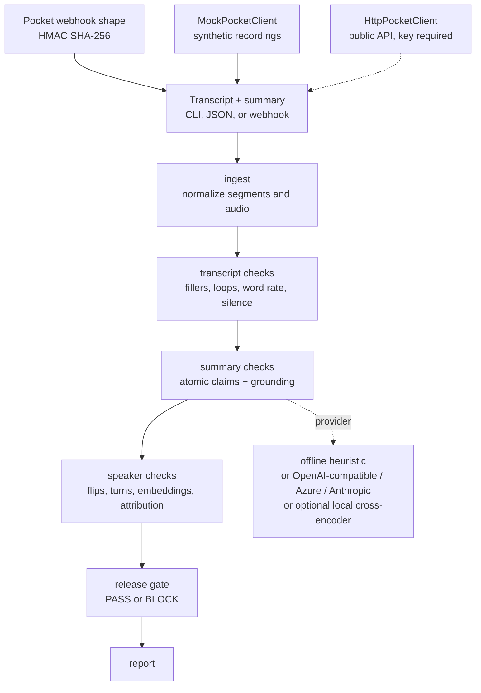

# Pocket Transcript QA

Independent evaluation harness for voice transcripts and the summaries written from them.

**Milan Jain · Applied AI Engineer**

This project is not affiliated with, maintained by, or endorsed by [Pocket](https://heypocket.com). It does not ship a Pocket API key, and it does not call Pocket unless you point the live client at your own key.

## Problem

A voice recorder is only as trustworthy as the note it hands back. A summary can add a budget, a decision, or a name that nobody said. A transcript can grow a sentence over a stretch of silence or a corrupted upload. A speaker label can flip in the middle of a sentence, and the summary can then quote the wrong person.

Pocket Transcript QA is a release gate for that last step. It splits a summary into claims, checks each claim against the transcript, looks for fabricated transcript spans (including when audio is available), and checks speaker-label consistency. Configurable thresholds return **PASS** or **BLOCK** with reasons. The same checks run as a CLI, a local FastAPI app, a LangGraph pipeline, and an MCP server.

### Publicly reported context

Pocket is a Y Combinator W26 company building a small AI voice recorder. The following is public reporting, not a claim about Pocket's internal systems, and not something this repository measures:

- On February 6, 2026, Pocket [posted](https://community.heypocket.com/t/transcription-quality-updates/1435) that reports of hallucinated transcripts had been traced to an issue affecting about 1–2% of recordings, which they attributed to corrupted audio uploads. They said the issue was fixed and that affected recordings were reprocessed.
- Pocket's community forum also has public threads about speaker labels, including a November 2025 discussion of [speaker tagging](https://community.heypocket.com/t/speaker-tagging-buggy/866).
- A public Y Combinator posting for [Research Engineer, Voice Intelligence](https://www.ycombinator.com/companies/pocket/jobs/TdcrUTp-research-engineer-voice-intelligence) describes an evaluation harness, offline and online, among the outcomes of the role.

This repository is an independent harness in that spirit. It does not use Pocket customer data. The benchmark is synthetic.

## Architecture



The LangGraph pipeline is six nodes with one job each: `ingest`, `transcript_checks`, `summary_checks`, `speaker_checks`, `gate`, `report`. Offline runs do not call a model. If you select `openai`, `azure`, or `anthropic`, only the summary-grounding stage calls it, and a failed model call fails closed as `unsupported`.

## Quickstart

Python 3.11 or newer. No API key.

```bash
pip install -e ".[dev]"
python scripts/generate_benchmark.py   # already frozen in data/benchmark
pocket-qa evaluate --transcript examples/standup.txt --summary examples/standup.summary.txt
pocket-qa evaluate --transcript examples/standup.txt --summary examples/faulty.summary.txt
pocket-qa bench
pocket-qa serve --host 127.0.0.1 --port 8741
```

Open [the local demo](http://127.0.0.1:8741). The faulty example exits 1, which is what you want in CI: the gate blocked the note.

```bash
pytest
ruff check src tests scripts
```

MCP (stdio), for a client that can launch a local process. This is **this project's** eval server, not Pocket's hosted MCP server:

```bash
pocket-qa mcp
```

```json
{
  "mcpServers": {
    "pocket-transcript-qa": {
      "command": "pocket-qa",
      "args": ["mcp"]
    }
  }
}
```

## Checks

**Summary hallucination.** The summary is split into sentences (abbreviations and decimals are protected). Each claim is judged `entailed`, `unsupported`, or `contradicted`, and the report quotes the transcript span that was used. Offline mode uses content-word overlap, number mismatch, negation, and a small closed antonym list. Speaker names on the transcript count as grounded mentions of who was present, not as proof of what they said.

**Transcript fabrication.** Flags known non-speech filler phrases (`Thanks for watching`, Amara.org credits, and similar), consecutive or in-span repetition loops, impossible word rates, timestamps that run backwards, and any sentence of at least four words whose audio RMS is below `0.01`. Audio uses the stdlib `wave` module.

**Speaker consistency.** Flags a speaker change that continues a sentence, long runs of alternating one- or two-word turns that are not backchannels (`yeah`, `ok`, `thanks`), a segment embedding closer to another speaker's leave-one-out centroid, and summary sentences of the form "Alice said …" / "According to Alice, …" when the words line up with someone else.

**Release gate.** Default policy blocks on any contradicted claim, an unsupported-claim rate above 0.15, a grounding score below 0.80, any fabricated segment, any speaker issue, or an empty summary. Pass a `thresholds` object to change it.

## Results

The table is written by `python scripts/run_benchmark.py --write-readme`. Do not edit the numbers by hand. This is a synthetic benchmark: the faults were injected on purpose, including a handful of cases the offline heuristic is expected to miss. It is not an estimate of precision on real meetings.

<!-- BENCHMARK_RESULTS_START -->
Generated by `python scripts/run_benchmark.py` at 2026-11-05T10:11:53Z UTC.
Offline provider. 68 synthetic recordings. Do not read these figures as production precision.

| Check | Precision | Recall | F1 | TP | FP | FN | Support |
| --- | ---: | ---: | ---: | ---: | ---: | ---: | ---: |
| Summary hallucination (recording) | 0.905 | 0.905 | 0.905 | 19 | 2 | 2 | 21 |
| Transcript fabrication (recording) | 1.000 | 0.850 | 0.919 | 17 | 0 | 3 | 20 |
| Speaker inconsistency (recording) | 1.000 | 0.895 | 0.944 | 17 | 0 | 2 | 19 |
| Release gate BLOCK (recording) | 0.961 | 0.875 | 0.916 | 49 | 2 | 7 | 56 |
| Hallucinated claims (claim) | 0.905 | 0.905 | 0.905 | 19 | 2 | 2 | 21 |
| Fabricated segments (segment) | 1.000 | 0.900 | 0.947 | 27 | 0 | 3 | 30 |

Three-way claim label accuracy (entailed / unsupported / contradicted): 0.962 on 104 claims.

A recording is positive for a check when the generator injected that fault. A prediction is positive when the offline checker emitted at least one finding of that type. The gate's positive class is the generator's `block` label, which is true when any fault was injected. Claim and segment rows are micro-averaged over every claim and every segment.
<!-- BENCHMARK_RESULTS_END -->

Per-case gold, predictions, and disagreements are in `results/benchmark_report.json` after a run.

## What is real, and what is a mock

| Piece | Status |
| --- | --- |
| Offline claim, fabrication, speaker, and gate checks | Real. They run with no network and no keys. |
| LangGraph pipeline, FastAPI, CLI, MCP tools | Real local software. |
| Synthetic benchmark and waveforms | Real files, invented data. See `data/benchmark/GENERATION.md`. |
| OpenAI-compatible, Azure, and Anthropic clients | Real HTTP clients. Unused unless you set keys. Not called by the benchmark. |
| Optional `local-nli` provider | Real code path for `cross-encoder/nli-deberta-v3-xsmall`. Not installed by default and not used in CI. |
| `HttpPocketClient` | Real client for the [public Pocket API](https://docs.heypocketai.com/docs/api) at `https://public.heypocketai.com/api/v1`. Paths, bearer auth, and the recording/webhook fields follow the public docs as of 2026-11-05. It does nothing without `POCKET_API_KEY`. This repo has no key, and nothing here calls the live API. |
| `MockPocketClient` | **Mock.** Synthetic recordings, no network. Default for `pocket-qa pull` and `/v1/pocket`. |
| `POST /v1/webhooks/pocket` | A real receiver for the [documented webhook shape](https://docs.heypocketai.com/docs/api/webhooks), including HMAC-SHA256 of `{timestamp}.{rawBody}` in `X-HeyPocket-Signature`. It is not registered with Pocket. Unsigned deliveries are refused unless `POCKET_QA_ALLOW_UNSIGNED_WEBHOOKS=1`. |
| Pocket's hosted MCP at `https://public.heypocketai.com/mcp` | Not wrapped. It needs a Pocket login or `pk_` key. `pocket-qa mcp` is a different server: it exposes these eval checks. |

The search endpoint's response schema was only partly expanded on the public docs page this client was written against. `HttpPocketClient.search` sends the documented `query` field (and `limit` only when you set it, in the documented 1–20 range) and returns the JSON body.

`GET /public/recordings/{id}` documents `summarizations: null` in its example. Summary text is taken from `v2.summary.markdown` when that object is present (the webhook example), or from `summary.markdown` on the organization recording endpoint. If neither is present, the summary is empty rather than guessed.

## Limitations

- Offline grounding is lexical. It misses conditions that were dropped from an otherwise copied sentence (`sum-cond-*`), and it false-flags faithful paraphrases that swap in different content words (`sum-para-*`). Both are in the benchmark on purpose.
- A fluent fabricated sentence with normal timing and no audio is invisible to the transcript checker (`tr-subtle-*`). Silence, repetition, fillers, and broken timestamps are the cues it actually has.
- Speaker attribution looks for a name plus a saying-verb, or "according to". Passive lines such as "requested by Alice" (`spk-passive-*`) are not parsed.
- Those four groups are the recording-level disagreements for the run that wrote the table. The same list is the `misses` field in `results/benchmark_report.json`.
- The antonym list is a closed set. Contradictions outside that list, and outside negation or number mismatch, are not detected as contradictions.
- Thresholds and the filler list will not transfer unchanged to production audio. The synthetic waveforms are noise, not speech, so the energy check is a fixture test, not a voice-activity model.
- The local server has no authentication. Keep it on localhost.
- No online metrics, no human adjudication UI, and no diarization model. Embeddings are an input, not something this project computes from audio.

## Roadmap

- A small human-labeled slice of public-domain speech, kept separate from the synthetic set, once redistribution and license notes are settled.
- Wire the optional cross-encoder in as a second offline column on the same benchmark, without making CI download weights.
- Calibrate gate thresholds on a set that was not used to pick the lexical cutoffs.
- Stream partial transcripts and decide when a live note is safe to show.
- Richer attribution (passive voice, pronouns, "the customer") behind the same provider interface.

## 60-second Loom

1. Open on the title and say: "This is an independent eval harness for voice transcripts and summaries. It is not a Pocket product."
2. Show `examples/standup.txt` and the matching summary. Run `pocket-qa evaluate` and point at `PASS`.
3. Swap in `examples/faulty.summary.txt`. Run it again. Point at the unsupported claim, the evidence span, and `BLOCK`. Mention the exit code is 1 so CI can stop a bad note.
4. Open `http://127.0.0.1:8741`, load "Text over near-silent audio", run the gate, and show the silent-audio flag.
5. Close on the benchmark table and one sentence: "The numbers are from a synthetic set, offline, with no API key. The Pocket client in the demo is a mock."

## License

MIT. Copyright 2026 Milan Jain. See [LICENSE](LICENSE).
