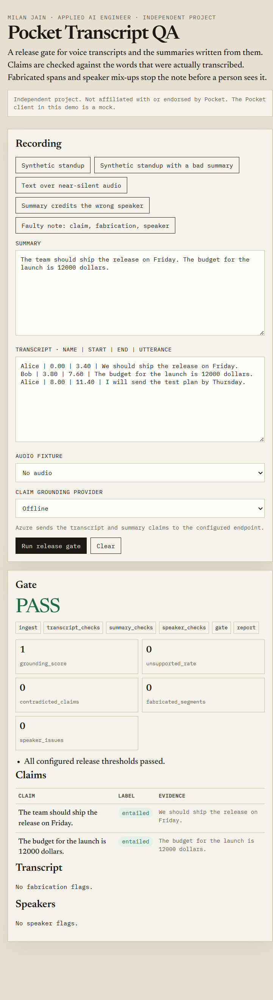
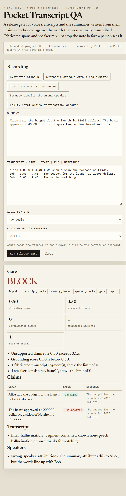
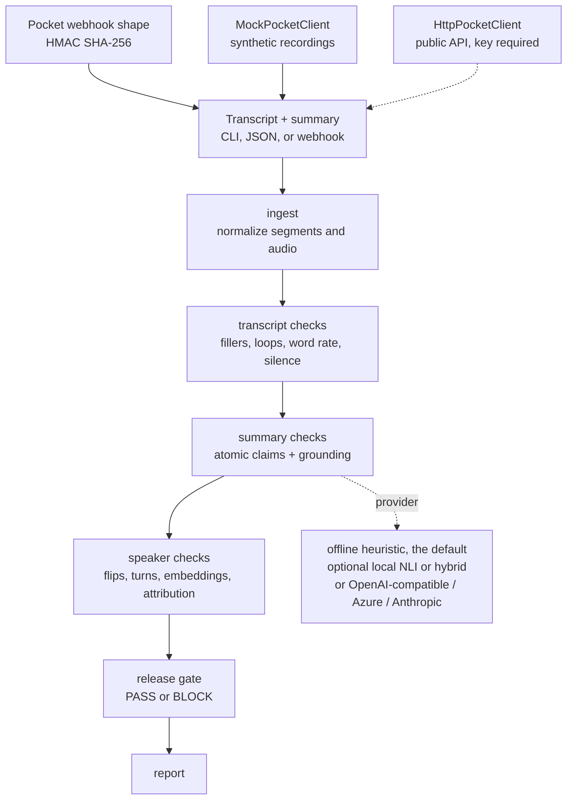
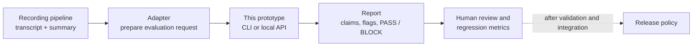

# Pocket Transcript QA

An independent prototype that checks voice transcripts and their summaries before a note is released.

**Milan Jain · Applied AI Engineer**

**Prototype, not a Pocket product.** This project is not affiliated with, maintained by, or endorsed by [Pocket](https://heypocket.com). The demo uses synthetic recordings and a mock Pocket client. The separate live client requires a Pocket API key.

## What it does

Given an **existing transcript and summary**, the prototype:

1. Checks each summary claim against the transcript and labels it `entailed`, `unsupported`, or `contradicted`.
2. Flags selected transcript problems, such as repeated phrases or text over near-silent audio.
3. Flags selected speaker-label and attribution problems.
4. Produces a **PASS** or **BLOCK** report with scores, reasons, and evidence.

It does **not** record audio, transcribe speech, generate summaries, or automatically block notes in Pocket. Audio and speaker checks are heuristics, not proof that the transcript or attribution is correct.

## Prototype screenshots

These are real captures of the local demo using synthetic data and the **offline** provider. In the BLOCK case, the prototype flags an invented acquisition, a filler phrase, and a wrong speaker attribution.

| Grounded example: PASS | Faulty example: BLOCK |
| --- | --- |
|  |  |

[View the earlier desktop demo screenshot](docs/demo-poster.png).

## How Pocket could use this

The immediate use is as an **evaluation and triage tool**, not an automated production decision-maker:

- **Regression testing:** run the same consented, human-labeled examples against different transcription or summarization versions and compare reports.
- **Error triage:** inspect flagged claims, transcript spans, and speaker issues to help reviewers investigate failures.
- **Release experiments:** try the gate in shadow mode first, measure false positives and missed errors, and calibrate thresholds before using its decisions.

These are proposed uses, not evidence that Pocket has adopted the prototype. The current benchmark is synthetic; it does not establish accuracy on real Pocket recordings. Human review, a representative labeled dataset, privacy review, and production security would be needed before relying on it.

## Problem

A voice recorder is only as trustworthy as the note it hands back. A summary can add a budget, a decision, or a name that nobody said. A transcript can grow a sentence over a stretch of silence or a corrupted upload. A speaker label can flip in the middle of a sentence, and the summary can then quote the wrong person.

Pocket Transcript QA is a release gate for that last step. It splits a summary into claims, checks each claim against the transcript, looks for fabricated transcript spans (including when audio is available), and checks speaker-label consistency. Configurable thresholds return **PASS** or **BLOCK** with reasons. The same checks run as a CLI, a local FastAPI app, a LangGraph pipeline, and an MCP server.

### Publicly reported context

Pocket is a Y Combinator W26 company building a small AI voice recorder. The following is public reporting, not a claim about Pocket's internal systems, and not something this repository measures:

- On February 6, 2026, Pocket [posted](https://community.heypocket.com/t/transcription-quality-updates/1435) that reports of hallucinated transcripts had been traced to an issue affecting about 1–2% of recordings, which they attributed to corrupted audio uploads. They said the issue was fixed and that affected recordings were reprocessed.
- Pocket's community forum also has public threads about speaker labels, including a November 2025 discussion of [speaker tagging](https://community.heypocket.com/t/speaker-tagging-buggy/866).
- A public Y Combinator posting for [Research Engineer, Voice Intelligence](https://www.ycombinator.com/companies/pocket/jobs/TdcrUTp-research-engineer-voice-intelligence) describes an evaluation harness, offline and online, among the outcomes of the role.

This repository is an independent harness in that spirit. It does not use Pocket customer data. The benchmark is synthetic.

## Architecture



The LangGraph pipeline is six nodes with one job each: `ingest`, `transcript_checks`, `summary_checks`, `speaker_checks`, `gate`, `report`. Offline runs do not call a model. `local-nli` and `hybrid` load an optional local cross-encoder and do not call a hosted API. If you select `openai`, `azure`, or `anthropic`, only the summary-grounding stage calls it, and a failed model call fails closed as `unsupported`.

### Possible integration (not implemented)



An adapter and any production release policy would need to be built separately. The existing webhook receiver can evaluate a documented payload, but it is not registered with Pocket and does not change Pocket's product.

## Quickstart

Python 3.11 or newer. Run these commands from the repository root. The default offline mode needs no API key.

```bash
python -m venv .venv
# macOS/Linux: source .venv/bin/activate
# Windows PowerShell: .\.venv\Scripts\Activate.ps1
pip install -e ".[dev]"
pocket-qa evaluate --transcript examples/standup.txt --summary examples/standup.summary.txt
pocket-qa evaluate --transcript examples/standup.txt --summary examples/faulty.summary.txt
pocket-qa bench
pocket-qa serve --host 127.0.0.1 --port 8741
```

Open [the local demo](http://127.0.0.1:8741), select **Synthetic standup**, and click **Run release gate** to see a PASS. Select **Faulty note: claim, fabrication, speaker** to see a BLOCK. The faulty CLI example exits with code 1 because the gate blocked the note. The local API has no authentication; keep it on localhost.

Optional local NLI. This is not the default, and CI does not install it. The first run downloads `cross-encoder/nli-deberta-v3-xsmall`. Later runs stay on disk. Transcripts are not sent to a model API.

```bash
pip install -e ".[local-nli]"
pocket-qa evaluate --transcript examples/standup.txt --summary examples/faulty.summary.txt --provider local-nli
pocket-qa evaluate --transcript examples/standup.txt --summary examples/faulty.summary.txt --provider hybrid
python scripts/compare_claim_support.py
```

`POCKET_QA_PROVIDER` changes the CLI default. The FastAPI demo stays on `offline` unless you select another provider.

### Azure OpenAI gateway (optional)

Install `pip install -e ".[azure]"`, then copy `.env.example` to `.env` and set
`AZURE_OPENAI_ENDPOINT`, `AZURE_OPENAI_API_KEY`, `AZURE_OPENAI_DEPLOYMENT`, and
`AZURE_OPENAI_API_VERSION`. Environment variables take precedence over `.env`.
For a gateway requiring a custom CA bundle, set `AZURE_OPENAI_CA_BUNDLE` to the
PEM file path (relative paths are relative to the repository). Keep the key
and any private certificate material out of Git.

Select `--provider azure` on the CLI or **Azure OpenAI** in the demo. This sends
the transcript and individual summary claims to the configured endpoint; audio
stays local. Only use recordings you are authorized to send. Model failures
fail closed as unsupported claims, with the error type in the report.

### Evaluate through the local API

With the server running, send a synthetic example to `POST /v1/evaluate`:

```bash
curl -X POST http://127.0.0.1:8741/v1/evaluate \
  -H "Content-Type: application/json" \
  -d '{"transcript":[{"speaker":"Alice","speaker_name":"Alice","text":"We should ship the release on Friday.","start":0,"end":3.4}],"summary":"The team should ship the release on Friday.","provider":"offline"}'
```

Inspect `gate.decision` and `gate.reasons`, `summary.claims`, `transcript.flags`, and `speakers.flags` in the response. Set `provider` to `azure` only after configuring the gateway and approving the data transfer. The browser demo also has an explicit provider selector.

```bash
pytest
ruff check src tests scripts
```

MCP (stdio), for a client that can launch a local process. This is **this project's** eval server, not Pocket's hosted MCP server:

```bash
pocket-qa mcp
```

```json
{
  "mcpServers": {
    "pocket-transcript-qa": {
      "command": "pocket-qa",
      "args": ["mcp"]
    }
  }
}
```

## Checks

**Summary hallucination.** The summary is split into sentences (abbreviations and decimals are protected). Each claim is judged `entailed`, `unsupported`, or `contradicted`, and the report quotes the transcript span that was used. The default, `offline`, uses content-word overlap, number mismatch, negation, and a small closed antonym list. Speaker names on the transcript count as grounded mentions of who was present, not as proof of what they said.

`local-nli` is opt-in. It scores the claim against each utterance, each adjacent pair, each adjacent triple, and the full transcript when that text is still short. Speaker names are prefixed onto utterances. A label is accepted only when its probability is at least 0.5 on its best span. Entailment wins if both entailment and contradiction clear that bar. Otherwise the claim is `unsupported`. The 0.5 bar is a majority of a three-way distribution. It was not tuned on this benchmark. Transcripts longer than 24 segments keep the 12 utterances with the most lexical overlap, plus their neighbors, before NLI. The synthetic set is shorter than that, so the published NLI numbers use the full span set.

`hybrid` runs the lexical checker first. It keeps that judgment when the claim uses a number that is not in the transcript, when the lexical label is `contradicted`, or when lexical recall is at least 0.90 and the best span does not add a conditional (`if`, `unless`, and the other markers in the source) that the claim dropped. Every other claim is re-judged by `local-nli`. The 0.90 bound was not grid-searched.

**Transcript fabrication.** Flags known non-speech filler phrases (`Thanks for watching`, Amara.org credits, and similar), consecutive or in-span repetition loops, impossible word rates, timestamps that run backwards, and any sentence of at least four words whose audio RMS is below `0.01`. Audio uses the stdlib `wave` module.

**Speaker consistency.** Flags a speaker change that continues a sentence, long runs of alternating one- or two-word turns that are not backchannels (`yeah`, `ok`, `thanks`), a segment embedding closer to another speaker's leave-one-out centroid, and summary sentences of the form "Alice said …" / "According to Alice, …" when the words line up with someone else.

**Release gate.** Default policy blocks on any contradicted claim, an unsupported-claim rate above 0.15, a grounding score below 0.80, any fabricated segment, any speaker issue, or an empty summary. Pass a `thresholds` object to change it.

## Results

The table is written by `python scripts/run_benchmark.py --write-readme`. Do not edit the numbers by hand. This is a synthetic benchmark: the faults were injected on purpose, including a handful of cases the offline heuristic is expected to miss. It is not an estimate of precision on real meetings.

<!-- BENCHMARK_RESULTS_START -->
Generated by `python scripts/run_benchmark.py` at 2026-11-05T10:11:53Z UTC.
Offline provider. 68 synthetic recordings. Do not read these figures as production precision.

| Check | Precision | Recall | F1 | TP | FP | FN | Support |
| --- | ---: | ---: | ---: | ---: | ---: | ---: | ---: |
| Summary hallucination (recording) | 0.905 | 0.905 | 0.905 | 19 | 2 | 2 | 21 |
| Transcript fabrication (recording) | 1.000 | 0.850 | 0.919 | 17 | 0 | 3 | 20 |
| Speaker inconsistency (recording) | 1.000 | 0.895 | 0.944 | 17 | 0 | 2 | 19 |
| Release gate BLOCK (recording) | 0.961 | 0.875 | 0.916 | 49 | 2 | 7 | 56 |
| Hallucinated claims (claim) | 0.905 | 0.905 | 0.905 | 19 | 2 | 2 | 21 |
| Fabricated segments (segment) | 1.000 | 0.900 | 0.947 | 27 | 0 | 3 | 30 |

Three-way claim label accuracy (entailed / unsupported / contradicted): 0.962 on 104 claims.

A recording is positive for a check when the generator injected that fault. A prediction is positive when the offline checker emitted at least one finding of that type. The gate's positive class is the generator's `block` label, which is true when any fault was injected. Claim and segment rows are micro-averaged over every claim and every segment.
<!-- BENCHMARK_RESULTS_END -->

Per-case gold, predictions, and disagreements are in `results/benchmark_report.json` after a run. The table above is only the offline provider. The drift check compares that block to a fresh offline run.

## Measured claim-support comparison

These figures were measured on this machine on 2026-11-11. They are the synthetic 68-recording set again, not production precision. The checkpoint was `cross-encoder/nli-deberta-v3-xsmall` on CPU, with sentence-transformers 6.2.0, torch 2.15.0, and Python 3.12.3. Loading the weights and scoring one warmup pair took 0.869534458999965 seconds. That load is not included in the per-recording times. The run wrote `results/provider_comparison.json` at 2026-11-11T07:50:04Z. Ratios below are exact counts. The floats are the values stored in that file. The offline summary row is the same scorer as the table above, which displays 19/21 as 0.905.

Summary hallucination is a recording-level check. A recording is positive when any claim is `unsupported` or `contradicted`. Support is 21.

| Provider | TP | FP | FN | Precision | Recall | F1 |
| --- | ---: | ---: | ---: | ---: | ---: | ---: |
| offline | 19 | 2 | 2 | 19/21 = 0.9047619047619048 | 19/21 = 0.9047619047619048 | 19/21 = 0.9047619047619048 |
| local-nli | 19 | 7 | 2 | 19/26 = 0.7307692307692307 | 19/21 = 0.9047619047619048 | 722/893 = 0.8085106382978723 |
| hybrid | 19 | 5 | 2 | 19/24 = 0.7916666666666666 | 19/21 = 0.9047619047619048 | 722/855 = 0.8444444444444444 |

Three-way claim labels, 104 claims: offline 100/104 = 0.9615384615384616, local-nli 90/104 = 0.8653846153846154, hybrid 95/104 = 0.9134615384615384.

Release gate, 56 recordings that should block. Transcript and speaker counts did not change, so this row moves only when the summary decision changes the gate.

| Provider | TP | FP | FN | Precision | Recall | F1 |
| --- | ---: | ---: | ---: | ---: | ---: | ---: |
| offline | 49 | 2 | 7 | 49/51 = 0.9607843137254902 | 49/56 = 0.875 | 4802/5243 = 0.9158878504672897 |
| local-nli | 50 | 1 | 6 | 50/51 = 0.9803921568627451 | 50/56 = 0.8928571428571429 | 100/107 = 0.9345794392523364 |
| hybrid | 49 | 0 | 7 | 49/49 = 1 | 49/56 = 0.875 | 98/105 = 0.9333333333333333 |

Full-pipeline wall time per recording, after the warmup, in seconds:

| Provider | Mean | Median | Min | Max |
| --- | ---: | ---: | ---: | ---: |
| offline | 0.002057402382355215 | 0.0016604885000219838 | 0.0015628800000513365 | 0.007301223000013124 |
| local-nli | 0.07857036122058669 | 0.057220072500001606 | 0.020774654999968334 | 0.6145176649999939 |
| hybrid | 0.02184387405882864 | 0.029602218000036373 | 0.0016371200000548924 | 0.07497753100005866 |

The offline maximum is `clean-01`, which is the first recording in the file, so that call also compiles the pipeline. The offline median is the steadier figure. For `local-nli`, every recording took at least 0.020774654999968334 seconds. The three slowest were the 7-segment embedding cases: `spk-embed-01` 0.6145176649999939, `spk-embed-03` 0.567576809000002, `spk-embed-02` 0.5577898099999175. The fastest was the one-segment `tr-silence-03` at 0.020774654999968334. For `hybrid`, 33 of 68 recordings finished in under 0.01 seconds and 35 took at least 0.01 seconds, which is why the median is higher than the mean.

What each mode got wrong on claim labels:

- Offline still misses the two dropped conditions (`sum-cond-01`, `sum-cond-02`: gold `unsupported`, predicted `entailed`) and false-flags the two paraphrases (`sum-para-01`, `sum-para-02`: gold `entailed`, predicted `unsupported`).
- `local-nli` and `hybrid` both accept those paraphrases, and both still call the dropped conditions `entailed`. A separate single-pair probe, with the speaker name prefixed, scored "Alice: I will send the test plan if QA signs off on Thursday." against "I will send the test plan on Thursday." as `entailed` with probability 0.9460905137010027. "Mina: We can launch in March if the security review is finished." against "We can launch in March." was `entailed` at 0.9918207777018644. Those two probabilities are not the benchmark's multi-span scores. The benchmark labels for `sum-cond-01` and `sum-cond-02` were also `entailed`.
- `local-nli` misses `clean-07`. The claim "The draft does include the risk section." is gold `entailed`. The transcript is the question "Does the draft include the risk section?", the answer "Yes.", and "The risk section is on page four." Lexical recall against the question is 1.0, so offline and hybrid keep `entailed`. `local-nli` predicted `unsupported`.
- `local-nli` labels some absent claims `contradicted` instead of `unsupported`: `sum-unsup-01`, `sum-unsup-03`, `sum-unsup-04`, `sum-unsup-05`, and `mix-01`. At recording level those still count as a summary finding. `hybrid` keeps the lexical label when the claim contains a number that is not in the transcript, so `sum-unsup-01` and `mix-01` stay `unsupported`. It still sends `sum-unsup-03` to NLI (lexical recall 1/6 = 0.16666666666666666 on "Counsel placed a litigation hold on the export servers.") and the model calls it `contradicted`. The same happens for `sum-unsup-04`.
- Wrong-speaker sentences such as "Priya said the candidate has seven years of backend experience." are gold `entailed` in this set. The speaker check is a separate label, and the claim label stays `entailed` because the proposition occurs in the transcript. `local-nli` predicted `contradicted` for `spk-attr-02`, `spk-attr-03`, `spk-attr-04`, `spk-attr-05`, `spk-passive-01`, and `mix-03`. `hybrid` did the same except `spk-passive-01`. That is a miss against this gold, not an extra point.
- The `local-nli` gate recall bump (FN 6 instead of 7) is `spk-passive-01`. The speaker checker misses that passive attribution, and the false `contradicted` claim blocks the recording anyway. `hybrid` does not do that, so its gate recall stays 49/56. `hybrid` gate false positives are 0 because the two paraphrase recordings are no longer blocked and `clean-07` is not newly blocked.

`local-nli` is slower than offline on every recording here (mean 0.07857036122058669 seconds against 0.002057402382355215). `hybrid` is faster than `local-nli` and slower than offline.

I kept `hybrid` as an opt-in provider because, on these counts, it is ahead of `local-nli` on summary F1, claim-label accuracy, gate false positives, and speed. I did not make it the default. Summary-hallucination F1 and claim-label accuracy are both worse than the lexical checker. The gate's higher precision is the two paraphrase false blocks going away, paid for with wrong `contradicted` labels on attribution sentences.

## Run on your own recordings

With the default offline provider, real transcripts and summaries stay on this machine and no API key is needed. A hosted provider sends transcript text and summary claims to that model provider; audio remains local. The command does not call Pocket. Do not commit the files or a report that quotes them. `recordings/`, `my-recordings/`, and `reports/local/` are in `.gitignore` for that reason.

The synthetic examples are safe to commit. Your own exports are not.

```bash
pocket-qa recordings \
  --transcript examples/standup.txt \
  --summary examples/standup.summary.txt \
  --output /tmp/standup-report.json

pocket-qa recordings --input recordings --output reports/local
```

The command prints a privacy notice for the selected provider. Exit code 0 means every note PASS-ed. Exit code 1 means at least one note was BLOCK-ed. Exit code 2 is a bad path or a provider that is not installed.

Folder layout:

```text
recordings/
  <name>/
    transcript.txt     # or transcript.md / transcript.json
    summary.txt        # or summary.md / summary.json
    audio.wav          # optional
  <name>.json          # optional Pocket-shaped export or {transcript, summary}
```

`transcript.txt` uses `Name | start_seconds | end_seconds | utterance`, or a JSON list of segments. A JSON export may be a Pocket recording (`transcript.segments` plus `summarizations`), a documented webhook body, or this project's evaluate payload. Summary text is read from `summary.txt`, from `v2.summary.markdown` when that object is present, or from `summary.markdown`. If none of those is present, the summary is empty and the gate blocks it. The summary is not guessed from another field.

`--provider` accepts `offline` (the default), `local-nli`, `hybrid`, `azure`, `openai`, or `anthropic`. The report JSON repeats the provider-specific privacy notice.

## What is real, and what is a mock

| Piece | Status |
| --- | --- |
| Offline claim, fabrication, speaker, and gate checks | Real. They run with no network and no keys. |
| LangGraph pipeline, FastAPI, CLI, MCP tools | Real local software. |
| Synthetic benchmark and waveforms | Real files, invented data. See `data/benchmark/GENERATION.md`. |
| OpenAI-compatible, Azure, and Anthropic clients | Real HTTP clients. Unused unless you set keys. Not called by the benchmark. |
| Optional `local-nli` provider | Real local cross-encoder path for `cross-encoder/nli-deberta-v3-xsmall`. Not installed by default, not used by CI, and not the default CLI provider. The first run downloads weights from Hugging Face. Inference is local. | 
| Optional `hybrid` provider | Real. Lexical check first, then the same local cross-encoder for claims the lexical check does not treat as decisive. Same install and same opt-in rules as `local-nli`. |
| `HttpPocketClient` | Real client for the [public Pocket API](https://docs.heypocketai.com/docs/api) at `https://public.heypocketai.com/api/v1`. Paths, bearer auth, and the recording/webhook fields follow the public docs as of 2026-11-05. It does nothing without `POCKET_API_KEY`. This repo has no key, and nothing here calls the live API. |
| `MockPocketClient` | **Mock.** Synthetic recordings, no network. Default for `pocket-qa pull` and `/v1/pocket`. |
| `POST /v1/webhooks/pocket` | A real receiver for the [documented webhook shape](https://docs.heypocketai.com/docs/api/webhooks), including HMAC-SHA256 of `{timestamp}.{rawBody}` in `X-HeyPocket-Signature`. It is not registered with Pocket. Unsigned deliveries are refused unless `POCKET_QA_ALLOW_UNSIGNED_WEBHOOKS=1`. |
| Pocket's hosted MCP at `https://public.heypocketai.com/mcp` | Not wrapped. It needs a Pocket login or `pk_` key. `pocket-qa mcp` is a different server: it exposes these eval checks. |

The search endpoint's response schema was only partly expanded on the public docs page this client was written against. `HttpPocketClient.search` sends the documented `query` field (and `limit` only when you set it, in the documented 1–20 range) and returns the JSON body.

`GET /public/recordings/{id}` documents `summarizations: null` in its example. Summary text is taken from `v2.summary.markdown` when that object is present (the webhook example), or from `summary.markdown` on the organization recording endpoint. If neither is present, the summary is empty rather than guessed.

## Limitations

- Default offline grounding is lexical. It misses conditions that were dropped from an otherwise copied sentence (`sum-cond-*`), and it false-flags faithful paraphrases that swap in different content words (`sum-para-*`). Both are in the benchmark on purpose.
- On that same set, `local-nli` and `hybrid` accept the paraphrases and still miss the dropped conditions. They also mark some gold-`entailed` attribution sentences as `contradicted`. Summary-hallucination F1 is lower than offline for both. The measured section has the counts. The 0.5 probability bar and the hybrid 0.90 recall bound were not fit on this set, and they were not changed after the run.
- A fluent fabricated sentence with normal timing and no audio is invisible to the transcript checker (`tr-subtle-*`). Silence, repetition, fillers, and broken timestamps are the cues it actually has.
- Speaker attribution looks for a name plus a saying-verb, or "according to". Passive lines such as "requested by Alice" (`spk-passive-*`) are not parsed.
- Those four groups are the recording-level disagreements for the run that wrote the table. The same list is the `misses` field in `results/benchmark_report.json`.
- The antonym list is a closed set. Contradictions outside that list, and outside negation or number mismatch, are not detected as contradictions.
- Thresholds and the filler list will not transfer unchanged to production audio. The synthetic waveforms are noise, not speech, so the energy check is a fixture test, not a voice-activity model.
- The local server has no authentication. Keep it on localhost.
- No online metrics, no human adjudication UI, and no diarization model. Embeddings are an input, not something this project computes from audio.

## Roadmap

- A small human-labeled slice of public-domain speech, kept separate from the synthetic set, once redistribution and license notes are settled.
- Keep CI on the lexical default. The optional cross-encoder is a second column, measured by `scripts/compare_claim_support.py`, and it is not part of the README drift check.
- Calibrate gate thresholds on a set that was not used to pick the lexical cutoffs.
- Stream partial transcripts and decide when a live note is safe to show.
- Richer attribution (passive voice, pronouns, "the customer") behind the same provider interface.

## 60-second Loom

1. Open on the title and say: "This is an independent eval harness for voice transcripts and summaries. It is not a Pocket product."
2. Show `examples/standup.txt` and the matching summary. Run `pocket-qa evaluate` and point at `PASS`.
3. Swap in `examples/faulty.summary.txt`. Run it again. Point at the unsupported claim, the evidence span, and `BLOCK`. Mention the exit code is 1 so CI can stop a bad note.
4. Open `http://127.0.0.1:8741`, load "Text over near-silent audio", run the gate, and show the silent-audio flag.
5. Close on the benchmark table and one sentence: "The numbers are from a synthetic set, offline, with no API key. The Pocket client in the demo is a mock."

## License

MIT. Copyright 2026 Milan Jain. See [LICENSE](LICENSE).
